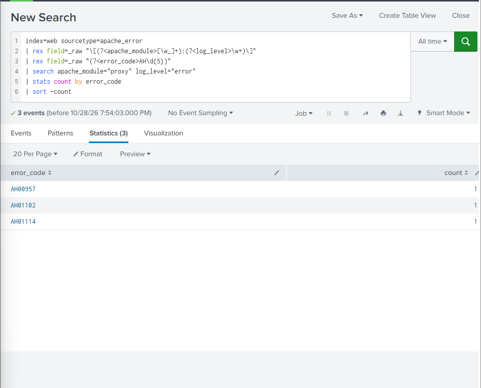

# Apache Log Onboarding — Test Results

## Test Environment

I validated the Apache log onboarding configuration in a Splunk Enterprise test environment. My validation focused on data ingestion, sourcetype assignment, timestamp recognition, and SPL-based troubleshooting.

I ingested representative Apache access and error log samples into the `web` index and verified the results using SPL.

**Environment details:**
- Platform: Splunk Enterprise
- Index: `web`
- Host: `ecommerce-web01`
- Sourcetypes: `access_combined`, `apache_error`
- Data source: Synthetic Apache web server logs

## SPL Validation Results

| Test | Result | Status |
|---|---|---|
| Apache access log ingestion | 8 events indexed | Passed |
| HTTP error analysis | 4 errors: 500 (2), 404 (1), 503 (1) | Passed |
| Checkout failure investigation | 2 HTTP 500 errors: GET and POST | Passed |
| Apache error log ingestion | 4 events indexed | Passed |
| Backend proxy error analysis | 3 errors: AH00957, AH01102, AH01114 | Passed |

## Investigation Findings

I confirmed that all eight Apache access log events and four Apache error log events were successfully indexed.

During the HTTP error analysis, I identified four failed requests, including two HTTP 500 responses associated with the `/checkout` endpoint.

I investigated the Apache error logs to look for additional information and identified three proxy-related errors.

These findings suggest a possible backend communication issue. Further correlation with application logs and request timestamps would be required to confirm the root cause.

## Validation Scope

This validation was performed using synthetic Apache log samples manually uploaded into Splunk Enterprise.

The tests confirmed successful indexing and execution of the documented SPL searches. Universal Forwarder collection, Deployment Server distribution, and end-to-end forwarding remain outside the scope of the completed tests.

## Validation Evidence

### Apache Backend Error Analysis

The screenshot below shows the SPL search results from my Splunk Enterprise test environment. I identified three Apache proxy error codes: AH00957, AH01102, and AH01114.

